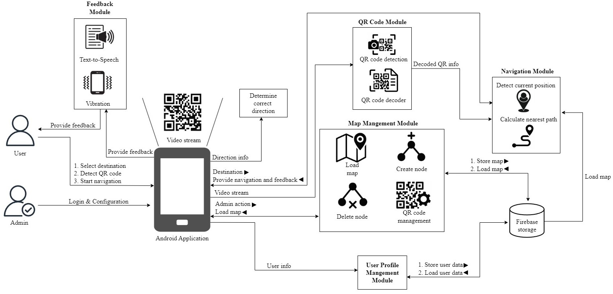

<div align="center">

# 🧭 Indoor QR Navigation for Visually Impaired Users

### A QR code-based indoor navigation prototype with accessible guidance

[▶️ Watch Project Demo](https://youtu.be/hXfcT_5vR5Y) · [🏗️ System Architecture](#️-overall-system-architecture) · [⚙️ Getting Started](#️-getting-started)

</div>

---

## 🎯 Project Overview

Indoor QR Navigation is an academic prototype designed to support indoor wayfinding for visually impaired users. It uses **floor-placed QR codes** as location checkpoints, **A\* pathfinding** to calculate routes, **compass-based heading checks** to detect deviations, and **spoken instructions and vibration** for guidance.

The project includes an **Android navigation application**, a **Python Flask backend**, and a **web-based floor-map editor** for configuring navigation nodes and generating QR codes. The prototype was evaluated in a controlled indoor environment at UTAR Kampar.

> **Scope:** This is a coursework prototype, not a certified mobility or safety aid. Testing described in the project report involved sighted participants simulating visual impairment, rather than validation with visually impaired users.

## ✨ Key Features

- **📷 QR Code Localization:** Scan floor-based QR markers to identify the current navigation checkpoint.
- **🧭 A\* Route Planning:** Compute a route through connected nodes on an indoor floor map.
- **📐 Compass-Based Direction Checking:** Compare device heading against the expected bearing and identify off-path movement.
- **🔊 Accessible Feedback:** Provide text-to-speech navigation instructions and vibration alerts.
- **🗺️ Floor Map Editor:** Create and connect nodes, configure map orientation, and export map data.
- **🏷️ QR Code Generation:** Generate QR markers for the configured navigation points.
- **📱 Android Interface:** Select a destination and follow guidance as QR checkpoints are scanned.

## 🛠️ Technologies Used

| Area | Technology |
|---|---|
| Android application | Kotlin, Jetpack Compose, CameraX, Google ML Kit Barcode Scanning |
| Backend & APIs | Python, Flask |
| Route planning | A\* shortest-path algorithm |
| Direction & feedback | Android compass sensors, text-to-speech, haptic feedback |
| Web map editor | HTML, CSS, JavaScript, Flask, Flask-CORS |
| QR code generation | Python `qrcode`, Pillow |
| Map data | JSON |
| Development tools | Android Studio, PyCharm / Python IDE |

## 🏗️ Overall System Architecture

<div align="center">



*Overall system architecture diagram*

</div>

### Main Components

1. **Android client** — destination selection, QR scanning, compass readings, and accessible navigation feedback.
2. **Navigation backend** — stores the route graph in memory, calculates the shortest path, and serves navigation APIs.
3. **Web map editor** — prepares floor plans, map nodes, connections, and printable QR codes.
4. **Map configuration** — JSON-based node and connection data consumed by the backend.

## 🔄 Navigation Workflow

1. An administrator prepares the floor map and connects navigation nodes using the web editor.
2. The Android app connects to the Flask backend and loads available destinations.
3. The user selects a destination and scans a nearby floor QR marker to establish a starting point.
4. The backend identifies the current node and computes the route using A\*.
5. The app presents navigation instructions through speech and vibration.
6. Subsequent QR scans and compass checks update guidance until the destination is reached.

## 🧪 Testing & Evaluation

The project report documents testing across **distance, camera angle, lighting, motion blur, partial obstruction, and QR placement**.

| Metric | Reported result |
|---|---|
| Successful QR detections | **21 / 26** test conditions |
| Detection success rate in this test set | **80.77%** |
| Mean response time for successful detections | **0.08 s** |
| Observed successful-detection response-time range | **0.04 – 0.13 s** |

The report notes failures in conditions including complete darkness, rapid motion, and some longer-distance oblique scans. Pilot usability work involved **five sighted participants simulating visual impairment**. These results describe the tested prototype and should not be interpreted as a guarantee of safety or performance in other environments.

## 📁 Repository Structure

```text
.
├── backend/                    # Flask navigation API, routing logic, map JSON
│   ├── app-backend.py
│   ├── map_compiled.json
│   └── requirements.txt
├── map-editor/                 # Web map editor and QR generation backend
│   ├── index.html
│   ├── map-backend.py
│   ├── js/
│   └── requirements.txt
├── mobile/
│   └── android-app/           # Kotlin / Jetpack Compose Android client
├── indoor-qr-system-architecture.jpg
└── README.md
```

## ⚙️ Getting Started

### 1. Start the Python navigation backend

Install Python and then, from the repository root:

```bash
cd backend
python -m pip install -r requirements.txt
python app-backend.py
```

The development backend is intended to run locally, using port **5000**.

### 2. Start the map editor backend

In a **separate terminal**, from the repository root:

```bash
cd map-editor
python -m pip install -r requirements.txt
python map-backend.py
```

Open `map-editor/index.html` using a local development server (for example, VS Code Live Server). The editor can prepare the graph data used by the navigation backend.

### 3. Configure and run the Android application

1. Open `mobile/android-app` in **Android Studio**.
2. In `app/src/main/java/com/example/indoornav/NavigationClient.kt`, change `baseUrl` to the **local IP address of your own backend computer**, followed by `:5000/api`.
3. Connect the Android device and backend computer to a network where they can reach each other.
4. Build and run the app in Android Studio, granting the required permissions when prompted.

**Note:** The repository currently includes a development IP address in the Android client. This must be adapted to your own setup. These steps are based on the supplied code and report; a fresh installation has not been independently tested.

## 🎬 Project Demonstration

<div align="center">

[](https://youtu.be/hXfcT_5vR5Y)

**[▶️ Watch the Full Project Demo on YouTube](https://youtu.be/hXfcT_5vR5Y)**

---

<div align="center"><sub>Developed as an academic prototype to explore accessible, low-cost indoor navigation.</sub></div>
